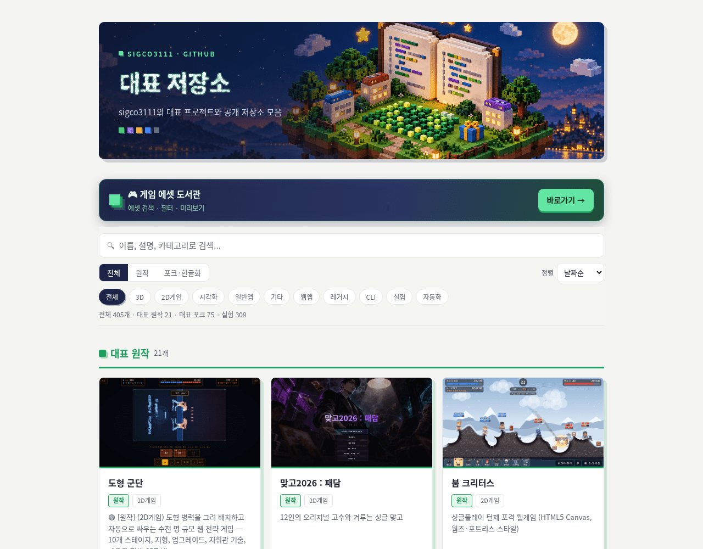
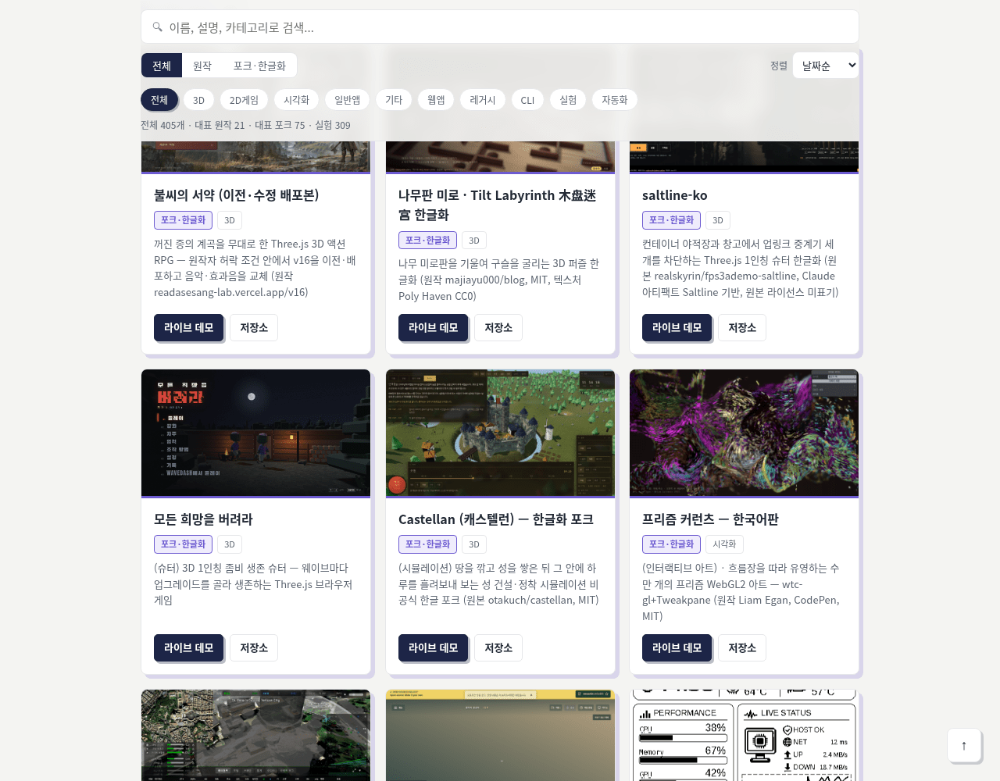
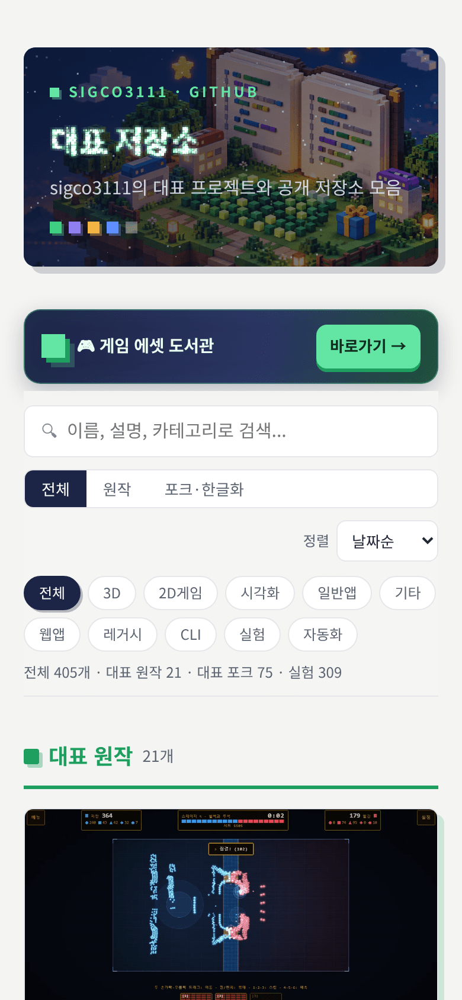

# 대표 저장소 쇼케이스

**sigco3111의 대표 프로젝트와 공개 저장소를 한눈에 보는 갤러리**

🔗 **라이브: [sigco3111.github.io/showcase](https://sigco3111.github.io/showcase/)**



## 소개

GitHub에 흩어져 있는 공개 프로젝트들을 한 페이지에 모은 쇼케이스입니다.
원작 프로젝트와 포크·한글화 프로젝트를 구분해서 보여주고, 검색·필터·정렬로
원하는 프로젝트를 빠르게 찾을 수 있습니다. 프로젝트 목록은 Notion 데이터베이스를
원본으로 매일 자동 동기화됩니다.

## 주요 기능

- **대표 카드 / 실험 목록** — 대표로 지정한 프로젝트는 스크린샷 카드(원작 · 포크 섹션 분리), 나머지 공개 프로젝트는 실험 목록으로 정리
- **원작 / 포크·한글화 필터** — 각 저장소 설명의 라벨([원작], [한글화/포크] 등) 기준으로 분류
- **카테고리 칩** — 3D, 2D게임, 시각화, 웹앱 등 카테고리별 필터링
- **검색** — 이름, 설명, 카테고리로 즉시 검색
- **정렬** — 날짜순(기본, 최신 프로젝트부터) · 가나다순 · 추천순
- **게임 에셋 도서관 바로가기** — 별도로 운영하는 에셋 카탈로그로 이동하는 배너
- **반응형 + 접근성** — 모바일 레이아웃 지원, `prefers-reduced-motion` 시 모든 모션 효과 자동 해제

## 사용법

1. [쇼케이스 페이지](https://sigco3111.github.io/showcase/)에 접속합니다.
2. 상단 검색창에 키워드를 입력하거나, `원작 / 포크·한글화` 버튼과 카테고리 칩으로 목록을 좁힙니다.
3. `정렬` 드롭다운에서 날짜순 · 가나다순 · 추천순을 선택합니다.
4. 카드의 **라이브 데모** 링크로 바로 실행해 보거나, **저장소** 링크로 코드를 확인합니다. (모든 링크는 새 탭으로 열립니다.)

| 포크·한글화 섹션 | 모바일 |
| --- | --- |
|  |  |

## 기술 상세

- **구성**: 프레임워크 없는 단일 정적 페이지 (`index.html` + 이미지 에셋). 빌드 과정이 없으며 GitHub Pages로 바로 배포됩니다.
- **데이터**: 프로젝트 정보가 `REPOS` 배열로 파일에 내장되어 있어 별도 서버나 API 없이 즉시 렌더링됩니다.
- **일일 자동 동기화**: 비공개 Notion 데이터베이스(프로젝트 관리 DB)를 원본으로, 매일 새 공개 프로젝트 추가 · 대표 지정 변경 · 비공개 전환 반영이 자동으로 이루어집니다. `sync-state.json`으로 동기화 상태를 추적합니다.
- **원작/포크 분류**: 각 저장소의 GitHub 설명 라벨을 기준으로 분류하며, GitHub의 fork 플래그와는 독립적으로 판별합니다.
- **추천순 정렬**: 비공개 평가 점수의 *순위*만 반영하고, 점수 숫자 자체는 공개하지 않습니다.
- **히어로 효과**: 복셀 아트 배경 위에 2D 캔버스 파티클 타이틀과 스크롤 리빌 애니메이션. 화면 밖이거나 탭이 숨겨지면 자동 일시정지하고, 모션 줄이기 설정 시 정적 화면으로 표시합니다.
- **썸네일**: 각 프로젝트 README의 실제 실행 스크린샷을 사용하며, 스크린샷이 없는 프로젝트는 정직한 표지 카드로 표시합니다.

## 로컬에서 실행

정적 파일 하나뿐이라 별도 설치가 없습니다.

```bash
git clone https://github.com/sigco3111/showcase.git
cd showcase
# 브라우저로 index.html을 열거나, 임의의 정적 서버 사용
python3 -m http.server 8000
```

## 라이선스 · 크레딧

- 이 저장소에는 별도의 라이선스 파일이 없습니다.
- 각 프로젝트 카드의 썸네일과 설명은 해당 저장소에서 가져온 것으로, 포크·한글화 프로젝트의 원작자와 라이선스는 각 카드 설명에 표기되어 있습니다.
- 쇼케이스 제작·동기화는 [Instinct](https://github.com/sigco3111) 개인 에이전트의 도움으로 운영됩니다.
